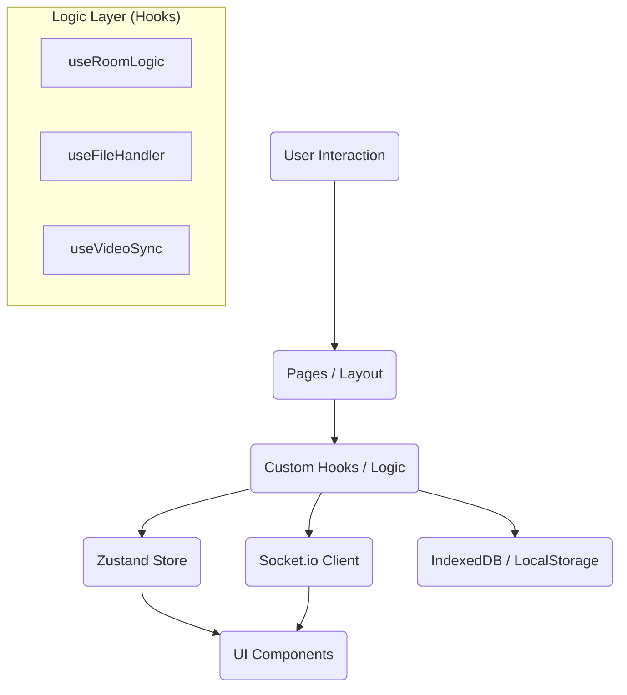

# Local Party Next - 项目指南与架构文档

**Local Party Next** 是对原 `local-party` 的现代化重构。这是一个支持 **异地同屏观看本地视频** 的全栈 Web 应用，强调**零上传**（视频不经过服务器）和**极致隐私**。

## 🤖 给 Gemini Agent 的核心上下文

当你在此目录下启动时，请务必参考以下文档：

1.  **`docs/CRITICAL_BUSINESS_RULES.md`**: 🔴 **必读**。包含了防死循环锁、iPad 兼容性、视频校验等核心“不可删除”的逻辑。
2.  **`docs/DATA_LIFECYCLE.md`**: 数据流转、内存回收与客户端缓存策略。
3.  **`docs/COMMUNICATION_PROTOCOL.md`**: 前后端 Socket 通信协议详解。

---

## 🛠 常用命令 (Cheat Sheet)

| 动作           | 命令              | 说明                                           |
| :------------- | :---------------- | :--------------------------------------------- |
| **启动开发**   | `pnpm dev`        | 同时启动前端 (:5173) 和后端 (:4000)            |
| **代码格式化** | `pnpm run format` | **提交前必跑**。使用 Prettier 美化全项目代码。 |
| **代码检查**   | `pnpm run lint`   | 检查 TS 类型错误和 ESLint 规范。               |

---

## 🏗 前端架构 (Architecture)

前端采用了 **逻辑与视图分离 (Logic-View Separation)** 的架构模式。

### 1. 数据流向图

### 2. 核心模块与文件职责

#### **🅰️ 页面层 (Pages)**

- **`src/pages/RoomPage.tsx`**: **控制器 (Controller)**。
  - 不包含底层逻辑。
  - 负责组装 Hooks，管理布局状态（如侧边栏折叠），根据 `videoUrl` 切换深浅主题。

#### **🅱️ 逻辑层 (Hooks)**

- **`src/hooks/useRoomLogic.ts`**: **房间业务**。
  - 处理登录、加入房间、自动重连、错误跳转。
- **`src/hooks/useFileHandler.ts`**: **文件系统**。
  - 封装 `showOpenFilePicker` 和降级 input。
  - 管理 `IndexedDB` 读写，实现“刷新即恢复”和权限再次请求。
- **`src/hooks/useVideoSync.ts`**: **同步引擎**。
  - 处理 `send_sync` / `receive_sync`。
  - 包含 **防抖 (Debounce)** 和 **死循环锁 (isRemoteAction)** 核心算法。

#### **©️ 组件层 (Components)**

- **`src/components/VideoPlayer.tsx`**:
  - 封装原生 `<video>`。包含 **透明点击遮罩 (iPad fix)** 和 **点击反馈动画 (Ping)**。
- **`src/components/ChatPanel.tsx`**:
  - 聊天渲染。自动将系统消息格式化为“胶囊”样式。
- **`src/components/UserItem.tsx`**:
  - 用户列表项。包含 **视频一致性校验 (红绿灯)** 和 **Portal Tooltip**。
- **`src/components/JoinModal.tsx`**: 补票弹窗 (Pop-in 动效)。
- **`src/components/StatusScreens.tsx`**: 错误页与 Loading 页。

#### **D. 状态与工具 (Store & Utils)**

- **`src/stores/useAppStore.ts`**: 全局状态 (User, Users, Socket)。
- **`src/utils/storage.ts`**: 客户端持久化工具 (基于 `idb-keyval`)。

---

## 🎨 UI/UX 设计规范 (Design System)

- **沉浸式主题**:
  - 未播放时：**浅色模式** (Gray-50)，通透干净。
  - 播放时：左侧平滑过渡到 **深色模式** (Gray-900)，专注观影。
- **微交互**:
  - **Toast**: 全局使用 `react-hot-toast`。
  - **动画**: 使用 `cubic-bezier` 实现非线性弹跳效果。

## 约束

最后必须使用 pnpm lint 来校验并且解决出现的问题

---

_文档更新时间: 2026-01-05_
