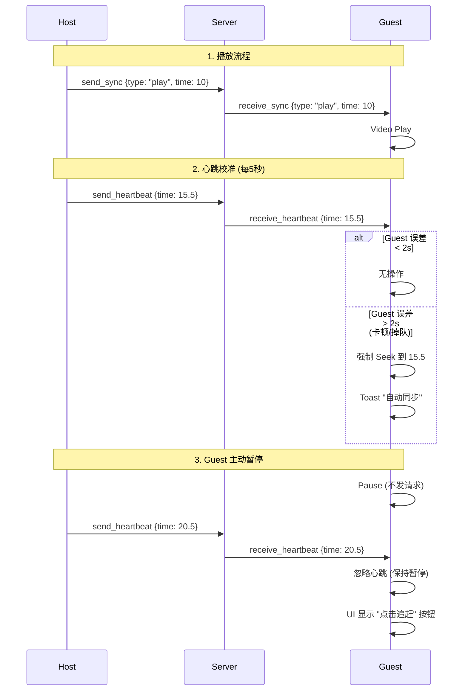

# Local Party Next 通信协议与交互流程文档

本文档详细描述了客户端 (`Client`) 与服务端 (`Server`) 之间的实时通信机制。本项目完全基于 **WebSocket (Socket.io)** 协议。

> **核心架构变更 (2026-01)**: 系统已从“P2P 民主同步”迁移至 **“房主权威 (Host-Authoritative) + 心跳同步”** 模式。

---

## 1. 连接建立 (Connection)

- **协议**: WebSocket (`wss` 推荐 / `ws`)
- **环境**: 开发环境需配置自签名证书以支持 HTTPS。
- **流程**: Client 连接 -> Server 分配 `socket.id` -> 监听 `connect`。

---

## 2. 房间管理 (Room Management)

### 2.1 创建/加入房间 (`create_room` / `join_room`)

- **Server 响应**:
  ```typescript
  {
    roomId: string,
    hostId: string, // 关键：告知客户端谁是房主
    currentStatus: SyncAction, // 房间当前的静态状态
    // ...
  }
  ```
- **初始化同步**:
  - 前端收到 `currentStatus` 后，结合本地时间戳 `lastActionAt` 计算流逝时间，直接跳转到最新进度。

### 2.2 状态上报 (`update_status`)

- **Payload**: `{ duration: number, fileName: string }`
- **用途**: 用于在成员列表中显示“红绿灯”状态（检查文件是否一致）。

---

## 3. 同步引擎 (Sync Engine) - 核心机制

### 3.1 权限模型

- **房主 (Host)**: 唯一有权发送 `send_sync` 和 `send_heartbeat` 的用户。
- **成员 (Guest)**: 只接收指令。本地操作（暂停/拖拽）**不会**发送给服务器，仅影响本地（允许暂时掉队）。

### 3.2 动作指令 (`send_sync` / `receive_sync`)

- **触发**: 房主进行 Play/Pause/Seek 操作。
- **Payload**: `{ type: 'play'|'pause'|'seek', timestamp: number }`
- **处理**: 成员收到后，立即执行对应动作，并校准时间。

### 3.3 心跳机制 (`send_heartbeat` / `receive_heartbeat`)

- **方向**: Host -> Server -> Guests
- **频率**: 每 **5秒** 一次 (仅当房主在播放时)。
- **Payload**:
  ```typescript
  {
    timestamp: number, // 房主当前的精确时间
    paused: boolean
  }
  ```
- **Server 处理**: 更新内存中的 `lastAction`，并广播给房间内所有人。
- **Guest 处理 (自动纠偏策略)**:
  1.  **若 Guest 处于暂停状态**: 忽略心跳（认为是用户主动暂停查看细节）。
  2.  **若 Guest 也在播放**:
      - 计算误差 `diff = abs(localTime - heartbeatTime)`。
      - 若 `diff > 2s`: **强制跳转** 到心跳时间，并弹出绿色 Toast 提示“已自动同步”。
      - 若 `diff < 2s`: 忽略（避免频繁跳变）。

---

## 4. 即时通讯 (Chat)

_(保持不变，参考原有逻辑)_

---

## 5. 异常与生命周期

### 5.1 房主移交

- 若房主断开连接 (`disconnect`)，Server 会自动将 `hostId` 移交给列表中的下一位用户，并广播 `host_updated` 事件。

### 5.2 房间销毁 (Grace Period)

- 房间空置后进入 **5分钟缓刑期**，期间若有人重连则恢复，否则销毁。

---

## 6. 数据流向总结图 (Host Mode)


