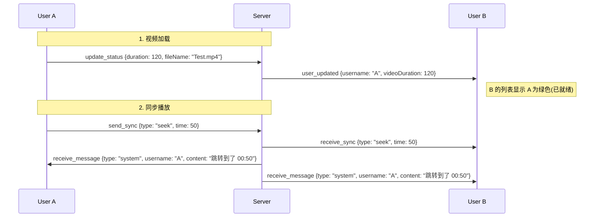

# Local Party Next 通信协议与交互流程文档

本文档详细描述了客户端 (`Client`) 与服务端 (`Server`) 之间的实时通信机制。本项目完全基于 **WebSocket (Socket.io)** 协议，不使用传统的 HTTP REST API 处理业务逻辑。

---

## 1. 连接建立 (Connection)

- **协议**: WebSocket (`ws` / `wss`)
- **鉴权**: 无（匿名连接，通过 `socket.id` 标识会话）。
- **握手流程**:
  1.  Client: `io(URL)` 发起连接。
  2.  Server: 接受连接，分配唯一 `socket.id`。
  3.  Client: 监听 `connect` 事件，置位 `connected: true`，开启自动重连机制。

---

## 2. 房间管理 (Room Management)

### 2.1 创建房间 (`create_room`)

- **方向**: Client -> Server
- **类型**: Request-Response (带 ACK 回调)
- **Payload**:
  ```typescript
  {
    username: string;
    roomName: string;
    password?: string;
    videoMeta: { duration: number; fileSize: number }
  }
  ```
- **Server 处理**:
  1.  生成 5 位随机 RoomID (e.g., "X9Z2A")。
  2.  在内存 `roomStore` 中实例化房间对象。
  3.  执行 `socket.join(roomId)`。
- **Server 响应 (ACK Callback)**:
  ```typescript
  { success: true, roomId: "X9Z2A" }
  ```

### 2.2 加入房间 (`join_room`)

- **方向**: Client -> Server
- **类型**: Request-Response (带 ACK 回调)
- **Payload**:
  ```typescript
  {
    roomId: string;
    username: string;
    password?: string;
    videoMeta: { duration: number; fileSize: number }
  }
  ```
- **Server 处理**:
  1.  校验 RoomID 和密码。
  2.  执行 `socket.join(roomId)`。
- **Server 响应 (ACK Callback)**:
  ```typescript
  { success: true, roomId: "X9Z2A" }
  ```
- **广播策略**:
  1.  **To Caller**: 发送 `room_joined` (含 `currentStatus: lastAction`)，用于自动同步。
  2.  **To Room**: 发送 `user_joined`。

### 2.3 状态上报 (`update_status`)

- **方向**: Client -> Server
- **触发**: 用户选择视频文件并成功加载元数据后。
- **Payload**:
  ```typescript
  {
    duration: number; // 视频时长 (秒)
    fileName: string; // 文件名
  }
  ```
- **Server 处理**: 更新内存中该 User 对象的属性。
- **广播**: 向房间内所有人发送 `user_updated` 事件。

---

## 3. 同步引擎 (Sync Engine)

### 3.1 发送同步指令 (`send_sync`)

- **方向**: Client -> Server
- **触发**: 用户操作播放器 (Play/Pause/Seek)。
- **Payload**:
  ```typescript
  {
    type: 'play' | 'pause' | 'seek';
    timestamp: number
  }
  ```
- **Server 处理**:
  1.  更新房间 `lastAction`。
  2.  **生成系统消息**:
      - `username`: 操作者名字 (如 "Jack")。
      - `content`: 纯动作文本 (如 "暂停了视频" 或 "跳转到了 01:20:30")。**不再拼接用户名。**

### 3.2 接收同步指令 (`receive_sync`)

- **方向**: Server -> Client
- **Client 处理**:
  1.  开启 `isRemoteAction` 锁 (持续 1200ms)。
  2.  操作 DOM 执行动作。

---

## 4. 即时通讯 (Chat)

### 4.1 发送消息 (`send_message`)
*   Payload: `string`

### 4.2 接收消息 (`receive_message`)
- **Payload**:
  ```typescript
  {
    id: string;
    type: 'text' | 'system';
    username: string; // 若为系统消息，此处为触发者名字
    content: string;  // 纯文本内容
    timestamp: number;
  }
  ```
- **Client 渲染**:
  - `text`: 普通气泡。
  - `system`: 渲染为“胶囊”样式。前端负责把 `username` 和 `content` 拼在一起显示 (e.g. `[Jack] 暂停了视频`)。

---

## 5. 异常与销毁

### 5.1 断开连接 (`disconnect`)
*   触发 `user_left` 广播。
*   若房间空，立即销毁。

### 5.2 错误反馈
*   事件: `error`
*   UI: 显示 Toast 提示。

---

## 6. 数据流向总结图 (更新版)

